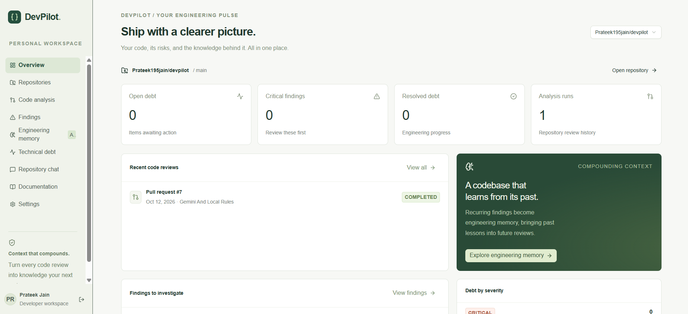
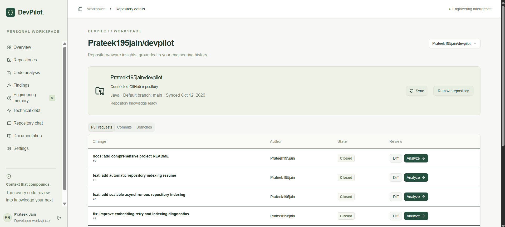
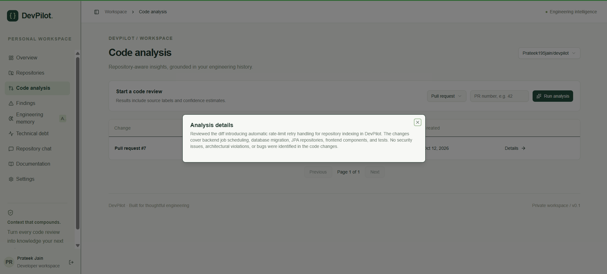
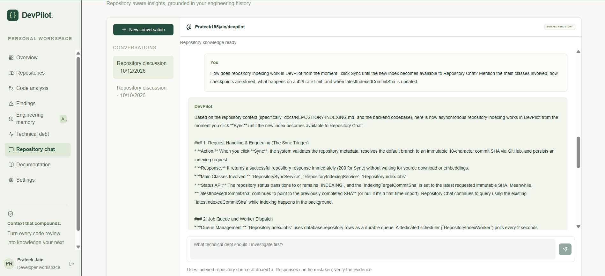
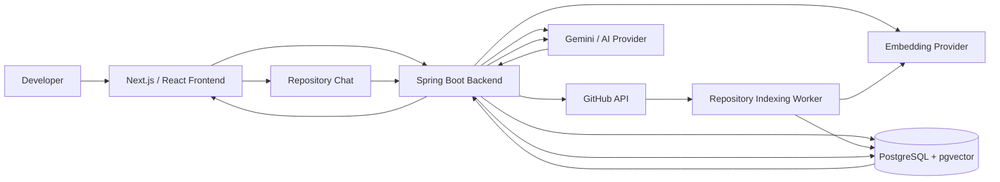

# DevPilot

**AI-powered engineering intelligence for understanding, reviewing, and maintaining software repositories.**

DevPilot connects to GitHub repositories, analyzes code changes, builds persistent engineering context, and lets developers ask repository-aware questions grounded in the actual codebase.

> **Live app:** https://devpilot-khaki.vercel.app

---

## What DevPilot does

DevPilot brings repository analysis, engineering knowledge, and AI-assisted reasoning into one workspace.

### Key capabilities

- **Repository-aware AI chat** with answers grounded in indexed source code
- **RAG with source citations** using PostgreSQL + pgvector
- **AI-assisted pull request analysis** using Gemini together with deterministic checks
- **Incremental repository indexing** that reuses unchanged embeddings
- **Asynchronous indexing** so large repositories do not block Sync requests
- **Automatic recovery from embedding rate limits**
- **Engineering memory** for recurring code-review patterns
- **Technical debt tracking**
- **GitHub repository integration** for pull requests, commits, branches, and source synchronization

---

# DevPilot in action

## Engineering overview

A central view of repository health, recent code reviews, findings, technical debt, and accumulated engineering context.



---

## GitHub repository intelligence

Connect a GitHub repository, synchronize source knowledge, inspect pull requests and commits, and launch AI-assisted analysis directly from the repository workspace.



---

## AI-assisted code review

DevPilot can analyze pull requests using **Gemini + deterministic local rules** and summarize issues related to bugs, security, maintainability, testing, and engineering quality.



---

## Repository-aware chat

Repository Chat answers implementation-specific questions using indexed repository source rather than relying only on generic model knowledge.

It can answer questions about:

- authentication flows
- architecture
- repository indexing
- internal services and classes
- implementation decisions
- technical debt
- code ownership and behavior



---

# Why I built DevPilot

DevPilot did not start with all of this architecture.

The project evolved as I tested it and found limitations that made it less useful in practice.

### 1. Deterministic analysis

The first version relied mainly on deterministic rules.

That worked for basic checks, but many answers were too generic and did not provide enough reasoning to be genuinely useful.

```text
Deterministic rules
        ↓
Useful for basic checks
        ↓
Too generic for deeper reasoning
```

So I integrated **Gemini**.

---

### 2. Gemini improved answer quality

Gemini significantly improved the quality of code-analysis responses.

However, another problem appeared.

The model only had limited context from:

- the current diff,
- existing analysis results,
- and repository metadata such as README content when available.

That meant it could not reliably answer deeper repository-specific questions such as:

- How does authentication work?
- How is repository indexing implemented?
- What is the architecture?
- Which classes are responsible for a particular feature?

This led to the next step.

---

### 3. Repository-aware RAG

I added repository-aware **Retrieval-Augmented Generation (RAG)**.

Repository source is:

```text
GitHub source
    ↓
deterministic chunking
    ↓
embeddings
    ↓
PostgreSQL + pgvector
    ↓
semantic retrieval
    ↓
repository context
    ↓
Gemini
    ↓
source-grounded answer
```

This allowed Repository Chat to retrieve relevant code before generating an answer.

The result was much more useful because the model could now reason about the actual implementation instead of only the current diff.

---

### 4. Large repositories exposed a new problem

RAG worked well on smaller repositories.

Larger repositories exposed another limitation:

```text
Large repository
      ↓
many source chunks
      ↓
many embedding requests
      ↓
provider rate limits / long indexing
```

Running repository indexing synchronously was not a good design.

That led to **asynchronous repository indexing**.

---

### 5. Incremental indexing

Re-embedding the complete repository after every Sync would waste time and embedding quota.

DevPilot therefore reuses existing vectors whenever possible.

Examples:

- unchanged files can reuse existing embeddings,
- unchanged GitHub blobs do not need to be downloaded again,
- content-preserving renames can reuse existing vectors,
- matching source chunks can reuse already generated embeddings,
- deleted files simply disappear from the next published index.

Conceptually:

```text
Old commit
    ↓
compare with new commit
    ↓
reuse unchanged vectors
    ↓
embed only new / changed chunks
    ↓
publish new repository index
```

---

### 6. Checkpointed indexing

A repository build may fail before every chunk has been processed.

Discarding all completed embeddings would make every retry expensive.

Instead, completed candidate chunks are persisted as reusable checkpoints.

```text
Indexing begins
     ↓
chunk 1 ✓
chunk 2 ✓
chunk 3 ✓
     ↓
rate limit / failure
     ↓
completed chunks preserved
     ↓
retry later
     ↓
reuse existing work
```

---

### 7. Automatic rate-limit recovery

Initially, embedding-provider `429` failures still required manual Sync attempts.

That was inconvenient and unreliable.

DevPilot now persists retry state in PostgreSQL.

After provider-level retries are exhausted:

```text
429 RATE LIMIT
      ↓
WAITING_RETRY
      ↓
next retry timestamp persisted
      ↓
worker lease released
      ↓
checkpointed vectors preserved
      ↓
automatic retry
      ↓
INDEXING
      ↓
READY
```

The default persisted retry progression is:

```text
5 min → 10 min → 20 min → 30 min
```

The retry state survives backend restarts because it is database-backed rather than dependent on an in-memory timer.

---

# Architecture



---

# Repository-aware RAG flow

When a developer asks a repository-specific question:

```text
User question
     ↓
query embedding
     ↓
pgvector similarity search
     ↓
relevant repository chunks
     ↓
context construction
     ↓
Gemini
     ↓
grounded answer
     ↓
source citations
```

Retrieval is scoped using repository ownership, embedding model, and the currently published commit.

This prevents unrelated repositories or incomplete candidate indexes from being used as context.

---

# Scalable repository indexing

Repository indexing is **asynchronous and commit-scoped**.

When Sync is triggered:

```text
Sync
 ↓
resolve latest immutable commit SHA
 ↓
persist indexing target
 ↓
return HTTP response immediately
 ↓
background worker claims repository job
 ↓
walk repository source tree
 ↓
reuse unchanged vectors
 ↓
embed missing chunks
 ↓
store candidate checkpoints
 ↓
validate complete candidate
 ↓
atomic publication
 ↓
latestIndexedCommitSha updated
```

The previously published repository index remains available to Repository Chat while a new target commit is being indexed.

---

## Atomic publication

Partially indexed repositories are never exposed to RAG retrieval.

Candidate chunks are stored as:

```text
published = false
```

Only after the complete repository build succeeds does DevPilot publish the candidate index and update:

```text
latestIndexedCommitSha
```

Publication happens atomically so Repository Chat sees either:

```text
previous complete index
```

or:

```text
new complete index
```

but never a partially built repository.

---

## Leases and fencing tokens

Background indexing uses database-backed leases.

A worker claims a repository indexing job and receives a fencing token.

This helps prevent stale or restarted workers from publishing invalid results after another worker has already taken ownership of the job.

---

# Indexing states

| Status | Meaning |
|---|---|
| `NOT_INDEXED` | Repository does not yet have a published source index |
| `INDEXING` | A repository target is actively being processed |
| `WAITING_RETRY` | Indexing is paused because of an exhausted rate limit and will retry automatically |
| `READY` | A complete repository index is available |
| `FAILED` | A non-recoverable indexing failure occurred |

---

# Reliability behavior

The repository indexing system is designed around a few important guarantees:

- partial indexes are never exposed to Repository Chat
- the previous index remains available while a new commit is being processed
- unchanged source can reuse existing vectors
- failed indexing attempts preserve valid checkpoints
- repeated Sync requests do not create duplicate active builds for the same repository
- newer requested commits can replace queued targets
- expired worker leases can be recovered
- `latestIndexedCommitSha` is changed only after successful publication
- exhausted embedding rate limits automatically enter a persisted retry flow

For deeper implementation details, see:

[`docs/REPOSITORY-INDEXING.md`](docs/REPOSITORY-INDEXING.md)

---

# Tech stack

| Layer | Technologies |
|---|---|
| Backend | Java 21, Spring Boot 3.5 |
| Backend frameworks | Spring Security, Spring Data JPA, Hibernate |
| Frontend | Next.js 16, React 19, TypeScript |
| Styling | Tailwind CSS |
| Database | PostgreSQL |
| Vector search | pgvector |
| AI | Gemini / configurable AI provider |
| Embeddings | Gemini Embedding |
| Authentication | JWT access + refresh-token flow |
| GitHub integration | GitHub REST API, Webhooks |
| Database migrations | Flyway |
| Backend testing | JUnit, Spring Boot Test, Testcontainers |
| Frontend testing | Node test runner |
| Local infrastructure | Docker Compose |
| Production frontend | Vercel |
| Production backend | Render |
| Production database | Neon PostgreSQL |

---

# Repository structure

```text
devpilot/
├── app/
│   └── Next.js routes
│
├── components/
│   └── DevPilot frontend UI
│
├── lib/
│   └── frontend API and utilities
│
├── tests/
│   └── frontend tests
│
├── backend/
│   ├── src/main/java/
│   │   └── Spring Boot application
│   │
│   ├── src/main/resources/
│   │   ├── application.yml
│   │   └── db/migration/
│   │
│   └── src/test/
│       └── backend and integration tests
│
├── docs/
│   └── architecture and implementation notes
│
├── compose.yml
└── package.json
```

---

# Running locally

## Prerequisites

Install:

- Java 21
- Node.js 22+
- pnpm
- Docker Desktop
- Git

---

## Clone the repository

```bash
git clone https://github.com/Prateek195jain/devpilot.git
cd devpilot
```

---

## Configure environment variables

Create a local `.env` file from:

```bash
cp .env.example .env
```

Required configuration includes secrets and provider settings such as:

```text
DATABASE_PASSWORD
JWT_SECRET
ENCRYPTION_KEY
WEBHOOK_SECRET

FRONTEND_ORIGIN

AI_MODE
AI_API_KEY
AI_MODEL

EMBEDDING_MODE
EMBEDDING_API_KEY
EMBEDDING_MODEL
```

Do not commit real secrets.

---

## Start PostgreSQL / pgvector

```bash
docker compose up -d db
```

---

## Start the backend

```bash
mvn -f backend/pom.xml spring-boot:run
```

Backend:

```text
http://localhost:8080
```

---

## Start the frontend

```bash
pnpm install
pnpm dev:docker
```

Frontend:

```text
http://localhost:5173
```

---

# Testing

## Backend

```bash
mvn -f backend/pom.xml test
```

The backend test suite includes PostgreSQL/pgvector integration coverage through Testcontainers.

Docker must be available for those tests.

---

## Frontend

```bash
pnpm test:client
pnpm typecheck
pnpm lint
```

---

# Current limitations

DevPilot is still evolving, and several areas can be improved further.

### Provider quota

Embedding throughput depends on the configured provider quota.

DevPilot can recover from rate limits, but it cannot bypass an exhausted external provider quota.

### Sleeping backend infrastructure

When deployed on infrastructure that suspends idle services, persisted retry state remains safe in PostgreSQL.

However, background retry work can only execute while the backend process is running.

### Chunking strategy

The current chunker is deterministic and size-based.

A future improvement could make chunking language-aware or AST-aware.

### Index retention

Historical published indexes and failed checkpoints currently remain stored.

A future retention / garbage-collection strategy could remove old data safely.

### GitHub availability

Repository synchronization still depends on GitHub API availability for metadata and source retrieval.

---

# Security considerations

- secrets are supplied through environment variables
- application APIs are protected using JWT authentication
- repository access is scoped to the owning user
- provider errors are sanitized before being returned to clients
- incomplete repository indexes are never exposed to retrieval
- source citations identify repository source rather than exposing embedding vectors

---

# Project status

DevPilot is being developed as a **production-style engineering intelligence platform** rather than as a collection of disconnected technologies.

Most of its current architecture came from repeatedly testing the application, finding real limitations, and evolving the design to solve them.

```text
Deterministic analysis
        ↓
Gemini reasoning
        ↓
Repository-aware RAG
        ↓
Asynchronous indexing
        ↓
Incremental indexing
        ↓
Checkpoint recovery
        ↓
Automatic rate-limit resume
```

---

Built by **[Prateek Jain](https://github.com/Prateek195jain)**
