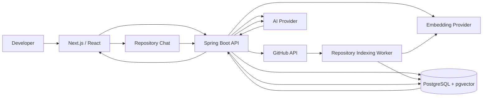

# DevPilot

**AI-powered engineering intelligence for understanding, reviewing, and maintaining software repositories.**

DevPilot connects to GitHub repositories, analyzes code changes, builds persistent engineering context, and provides repository-aware AI assistance with source-grounded answers.

> Live app: https://devpilot-khaki.vercel.app

## Why DevPilot exists

DevPilot evolved from a simple code-analysis tool into a repository-aware engineering assistant.

The first version relied on deterministic rules, which made many analysis results too generic to be genuinely useful. Gemini improved answer quality, but the model still lacked enough repository-specific context to explain features such as authentication, architecture, or internal workflows.

That led to repository-aware RAG. Once RAG was introduced, larger repositories exposed new problems: full indexing could hit embedding-provider rate limits, long-running Sync requests were fragile, and failed indexing required manual retries.

Those problems shaped the current architecture:

```text
Deterministic analysis
        ↓
Gemini-powered analysis
        ↓
Repository-aware RAG
        ↓
Asynchronous indexing
        ↓
Incremental vector reuse
        ↓
Persisted checkpoints
        ↓
Automatic rate-limit recovery
```

## Core capabilities

- **GitHub repository integration** — connect repositories, inspect pull requests, commits, branches, and source history.
- **AI-assisted code analysis** — analyze code changes and surface bugs, security concerns, testing gaps, maintainability issues, and architectural risks.
- **Repository-aware chat** — ask questions about implementation details, architecture, authentication, technical debt, and other repository-specific topics.
- **RAG with source citations** — retrieve relevant source chunks from PostgreSQL/pgvector and cite the files used to build an answer.
- **Engineering memory** — retain recurring engineering patterns and findings across repository activity.
- **Technical debt tracking** — convert findings into trackable debt items.
- **Documentation generation** — generate repository-grounded technical documentation.
- **Repository lifecycle management** — import, sync, index, and remove tracked repositories without modifying the original GitHub repository.

## Scalable repository indexing

Repository indexing is asynchronous and commit-scoped.

A Sync request resolves the latest immutable commit SHA, queues indexing, and returns immediately. The previous published index remains available to Repository Chat while the new candidate index is built.

### Incremental reuse

DevPilot avoids re-embedding unchanged code:

- unchanged files can reuse vectors using GitHub blob SHA + embedding model + chunker compatibility,
- modified files are deterministically re-chunked,
- exact matching chunk content can reuse an existing vector,
- deleted files are excluded from the new index,
- content-preserving renames can reuse vectors with updated citation paths.

### Checkpoints and atomic publication

Completed candidate chunks are stored with `published=false`.

If indexing fails, those chunks remain available as reusable checkpoints. A target commit becomes visible to retrieval only after the complete candidate index is validated and published atomically.

```text
Sync / Import
     ↓
Resolve immutable commit SHA
     ↓
Queue background indexing
     ↓
Reuse unchanged vectors
     ↓
Embed only missing/new chunks
     ↓
Store unpublished checkpoints
     ↓
Complete target commit
     ↓
Atomic publication
     ↓
latestIndexedCommitSha updated
     ↓
Repository Chat uses new index
```

## Automatic 429 recovery

Embedding-provider rate limits do not require repeated manual Sync attempts.

After provider-level retries are exhausted, the repository enters `WAITING_RETRY`. DevPilot persists the next retry timestamp and retry count, releases the worker lease, preserves all checkpoints, and automatically resumes when the cooldown expires.

Default persisted cooldown progression:

```text
5 min → 10 min → 20 min → 30 min
```

The retry state is database-backed, so it survives application restarts. Deterministic failures such as invalid configuration, authentication failures, malformed responses, or embedding dimension mismatches remain terminal failures instead of being retried indefinitely.

For the detailed indexing design, see [docs/REPOSITORY-INDEXING.md](docs/REPOSITORY-INDEXING.md).

## Architecture



## Tech stack

| Layer | Technologies |
|---|---|
| Backend | Java 21, Spring Boot 3.5, Spring Security, Spring Data JPA, Hibernate |
| Frontend | Next.js 16, React 19, TypeScript, Tailwind CSS |
| Database | PostgreSQL, pgvector |
| AI | Gemini / configurable AI provider |
| Embeddings | Gemini Embedding |
| Authentication | JWT access + refresh-token flow |
| Database migrations | Flyway |
| Integration | GitHub REST API, webhooks |
| Testing | JUnit, Spring Boot Test, Testcontainers, Node test runner |
| Local infrastructure | Docker Compose |
| Production | Vercel, Render, Neon PostgreSQL |

## Repository structure

```text
devpilot/
├── app/                    # Next.js application routes
├── components/             # Frontend UI and DevPilot screens
├── lib/                    # Frontend API/client utilities
├── tests/                  # Frontend tests
├── backend/
│   ├── src/main/java/      # Spring Boot application
│   ├── src/main/resources/ # Configuration + Flyway migrations
│   └── src/test/           # Backend and integration tests
├── docs/                   # Architecture / implementation notes
├── compose.yml
└── package.json
```

## Running locally

### Prerequisites

- Java 21
- Node.js 22+
- pnpm
- Docker Desktop
- Git

### 1. Clone the repository

```bash
git clone https://github.com/Prateek195jain/devpilot.git
cd devpilot
```

### 2. Configure environment variables

Copy the example environment file and generate/set local secrets.

```bash
cp .env.example .env
```

Important variables include:

```text
DATABASE_PASSWORD
JWT_SECRET
ENCRYPTION_KEY
WEBHOOK_SECRET
FRONTEND_ORIGIN
AI_MODE
AI_API_KEY
AI_MODEL
EMBEDDING_MODE
EMBEDDING_API_KEY
EMBEDDING_MODEL
```

Never commit real secrets.

### 3. Start PostgreSQL / pgvector

```bash
docker compose up -d db
```

### 4. Start the backend

```bash
mvn -f backend/pom.xml spring-boot:run
```

Backend:

```text
http://localhost:8080
```

### 5. Start the frontend

```bash
pnpm install
pnpm dev:docker
```

Frontend:

```text
http://localhost:5173
```

You can also run the full local stack with Docker Compose after configuring the required environment variables.

## Testing

Backend:

```bash
mvn -f backend/pom.xml test
```

Frontend:

```bash
pnpm test:client
pnpm typecheck
pnpm lint
```

PostgreSQL/pgvector integration tests use Testcontainers and require Docker.

## Indexing states

| Status | Meaning |
|---|---|
| `NOT_INDEXED` | Repository has no published knowledge index yet |
| `INDEXING` | A target commit is actively being built |
| `WAITING_RETRY` | Indexing is temporarily paused after an exhausted rate limit and will resume automatically |
| `READY` | A complete published index is available to Repository Chat |
| `FAILED` | A non-recoverable indexing failure occurred |

## Reliability guarantees

DevPilot's indexing design intentionally prioritizes correctness:

- partial candidate indexes are never exposed to RAG retrieval,
- the previous published index remains usable while a refresh is running,
- `latestIndexedCommitSha` changes only after successful atomic publication,
- repository jobs use leases and fencing tokens to prevent stale workers from publishing invalid state,
- checkpoints survive rate-limit failures and can be reused on later attempts,
- repeated Sync operations are coalesced instead of creating duplicate active jobs.

## Current limitations

- Embedding throughput still depends on the configured provider's quota.
- On infrastructure that sleeps when idle, persisted retry state survives, but scheduled work resumes only when the backend process is running again.
- GitHub metadata resolution still depends on live GitHub API availability.
- Published index history and failed checkpoints will eventually need a retention / garbage-collection policy.
- The current chunker is deterministic and size-based rather than language-AST-aware.

## Security notes

- Secrets are supplied through environment variables.
- Passwords are never stored in plaintext.
- JWT-based authentication protects application APIs.
- Repository ownership checks scope user access.
- Source citations expose repository paths/commit metadata, not embedding vectors.
- Provider errors are sanitized before being surfaced to clients.

## Project status

DevPilot is actively evolving as a production-style engineering platform. The focus is on repository-grounded intelligence, reliable indexing, safe failure recovery, and practical engineering workflows rather than adding features only for technology breadth.

---

Built by [Prateek Jain](https://github.com/Prateek195jain).
