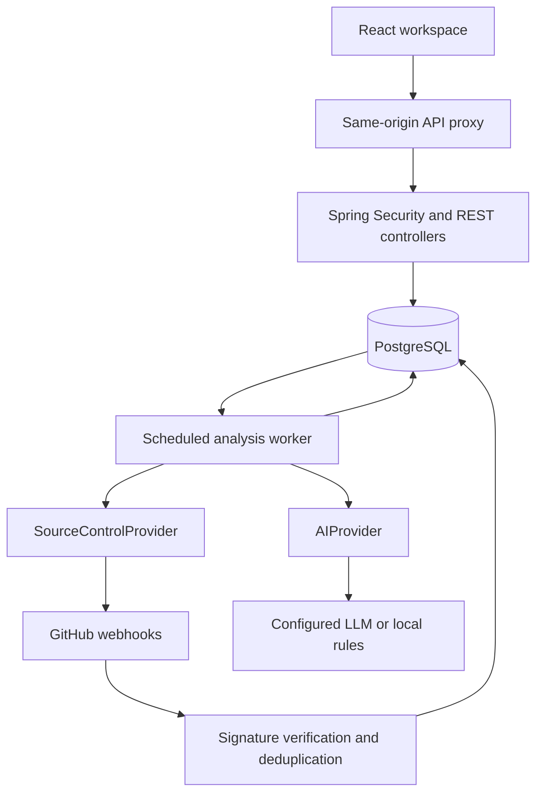
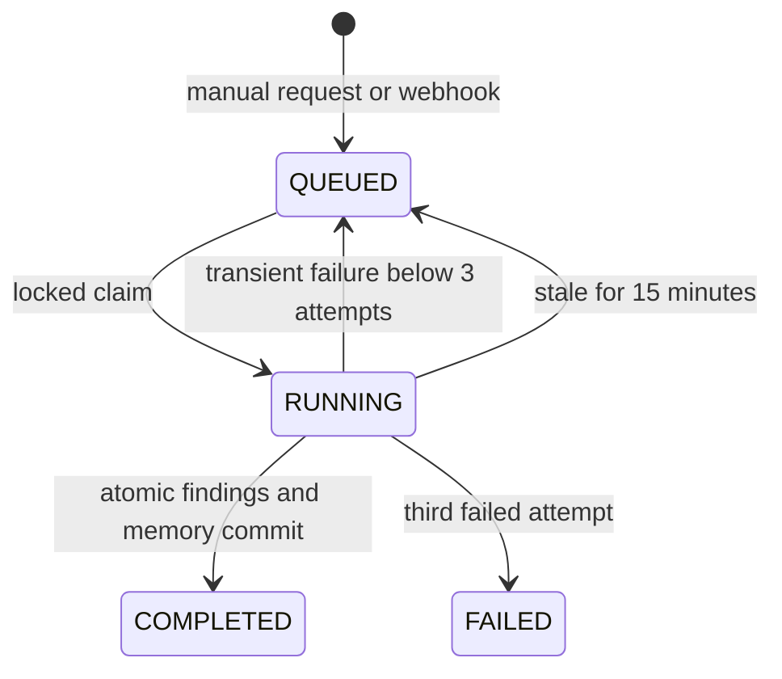

# Architecture

## Deployment and boundaries

DevPilot is a modular monolith. Spring owns identity, repository authorization, GitHub integration, asynchronous reviews and all persistence. The React frontend only holds transient UI state and an access token in memory. Its server route proxies `/api/v1/**` to the operator-configured Java backend; it never accepts a destination URL from the user.

Controllers validate DTOs and resolve the current owner before any child lookup. Services implement use cases; Spring Data stores handle persistence. DTO records explicitly select response fields, preventing encrypted tokens, hashes, or entity graphs from leaking into REST responses. Flat UUID references avoid eager association graphs and N+1 traversal. Foreign keys are enforced in the Flyway migration.

## Data model

| Table | Purpose / key constraints |
|---|---|
| users | Unique normalized email, BCrypt hash, USER/ADMIN role check |
| refresh_tokens | Unique SHA-256 token hash; user, expiry, revocation |
| github_integrations | One integration per user; encrypted token and GitHub login |
| repositories | Unique owner + GitHub ID; metadata and bounded README snapshot |
| webhook_events | Unique delivery ID, event type and payload digest; no raw payload retained |
| analyses | Repository + PR/commit reference; status, attempt, timestamps, bounded diff and summary |
| findings | Analysis/repository foreign keys; evidence, type, severity, confidence and fingerprint |
| engineering_memories | Unique repository + fingerprint; occurrences, first/last observation and status |
| technical_debt | Repository and optional source finding; unique repository + source finding |
| conversations | Repository, title, update timestamp and optimistic version |
| messages | Conversation, role, content, timestamp; history index |
| generated_documents | Unique repository + document kind + document version; immutable content |

Every entity has a UUID primary key, creation timestamp and optimistic version. Indexes cover foreign keys, job eligibility and message histories. The initial migration is `backend/src/main/resources/db/migration/V1__initial_schema.sql`; Hibernate validates rather than creates production tables. Enum-like values use validation and explicit database checks where implemented.

## Authentication

1. Registration normalizes email and validates password length in both characters and UTF-8 bytes. BCrypt is limited to 72 bytes; the minimum is 12 characters.
2. Login verifies BCrypt, using a dummy BCrypt hash for unknown accounts to reduce timing differences.
3. An HS256 JWT with issuer, subject, role, jti and ten-minute expiry is returned. The signing secret is operator-provided and at least 32 bytes.
4. A random 256-bit refresh token goes into an HttpOnly, SameSite=Strict cookie scoped to `/api/v1/auth`. Only its SHA-256 hash is stored.
5. Refresh pessimistically locks the token row, checks expiry/revocation, revokes it, and issues a replacement atomically.
6. The frontend shares one refresh request across simultaneous expired API requests, then retries once.
7. Logout revokes that refresh token and expires the cookie. Already issued access JWTs expire naturally.

Spring Resource Server validates signatures, issuer and expiration. Roles become `ROLE_USER`/`ROLE_ADMIN`. Repository ownership failures return 404 consistently, including nested resources. Refresh/logout reject missing or mismatched Origin headers. The frontend escapes text; generated Markdown is shown as text and downloaded rather than inserted as raw HTML.

## GitHub integration

`SourceControlProvider` defines neutral repository/change/snapshot records. `GitHubSourceControlAdapter` fixes the host to GitHub, uses WebClient, sets API headers, limits buffers and uses timeouts. Repository names and references are constrained before constructing paths. Tokens are encrypted using AES-256-GCM with a fresh 96-bit nonce and authentication tag.

Repositories are imported only after successful authorized metadata retrieval. Commits, PRs and branches are paginated live. Diffs are assembled from changed-file patches and retain file names. Binary/missing/oversized patches produce coverage warnings. README sync is best-effort and states when the README is unavailable.

## Webhook flow

Read at most 1 MiB of raw bytes → verify SHA-256 HMAC using a constant-time comparison → parse JSON → validate delivery metadata → insert unique delivery → find already imported matching GitHub repositories → enqueue appropriate analyses → commit → return 202.

Only the payload digest is retained. Duplicate deliveries with the same digest return success without enqueueing again. Reused delivery IDs with different content fail. Delivery insertion and job creation share a transaction; crashes roll back both. Simultaneous duplicate insertion is handled outside the rolled-back service transaction. `push` reviews the `after` commit; PR opened/reopened/synchronize/ready-for-review reviews the PR. Deleted branches and unrelated event types do not create work.

## Durable analysis flow

The scheduled worker claims one eligible row in a short transaction. It performs GitHub and AI requests after releasing database locks. A completion transaction locks the analysis and repository, validates the attempt/status fence, stores findings, merges memory, and marks completion atomically. Duplicate completion calls are no-ops. Retries wait 30 seconds times the attempt count. A crashed worker is recoverable after 15 minutes; the attempt fence prevents a late result from completing a newer attempt.

One worker processes sequentially per application instance. This is durable scheduling rather than an in-memory `@Async` queue. The current pessimistic query serializes claims; `SKIP LOCKED`, lease heartbeats, bounded executor pools and an outbox/broker become relevant under actual measured load.

A repository lock serializes enqueue checks and the daily budget. Concurrent requests for the same reference reuse QUEUED/RUNNING work. Completed references may be deliberately re-reviewed. New work is limited to 100 runs per repository in a rolling 24-hour window.

## AI, evidence and memory

`AIProvider` is the strategy interface. Conditional dependency injection selects one provider at startup. Local mode performs concrete pattern matching for dynamic execution, swallowed exceptions, stack traces, possible hardcoded credentials and absent test files in the supplied diff. All findings are explicitly labelled LOCAL_RULES and require review.

OpenAI mode uses a configurable compatible Chat Completions endpoint. It requests JSON, deserializes to DTO records, validates nested fields, finite confidence and allowed severity/type values, then checks the finding file and optional line against the actual bounded diff. A malformed response fails the job rather than silently creating incorrect records. Prompts treat code and history as untrusted evidence and cannot invoke tools. Common token formats are redacted; arbitrary secrets are not comprehensively recognized.

A fingerprint hashes type + exact file + normalized title. Occurrences count distinct completed analyses, never duplicate findings within one analysis. ACTIVE memories are retrieved by repository and occurrence count. ARCHIVED memories remain stored but do not feed future context. Grouping is deterministic and cheap, but wording differences produce separate memories and re-reviewing the same commit can increment its count. This is not semantic deduplication.

## Debt, chat and documents

A finding is promoted to debt only through a user action. Creation locks the repository and checks source-finding uniqueness; repeated promotions return the existing debt. Resolving sets resolvedAt; reopening clears it. Stats use database aggregates rather than loading every row.

Chat retrieves at most 12 prior messages, 15 recent findings, 10 active memory records, a bounded README and part of the latest successful diff, capped to 35,000 context characters. The remote answer is generated outside a transaction. A final short transaction locks the conversation and compares its optimistic version before persisting both messages. Concurrent stale answers are rejected with 409; an update timestamp advances the version.

Document generation similarly performs remote work first, then locks the repository to allocate a unique monotonically increasing version per kind. Earlier document rows are not overwritten. Local drafts clearly identify their evidence-only nature.

## Operations and scaling

Actuator exposes public health without detailed internals. A request filter generates a correlation ID and adds it to structured logs/response headers. Provider errors log only class, job ID and attempt—not remote error bodies, request bodies, credentials or code.

Before broad production use: validate against PostgreSQL under concurrency, enforce edge authentication limits, add per-user AI token budgets, secure transport, managed secret rotation, retention jobs, database backups/restores and monitoring/alerts. Retained refresh tokens, webhook IDs, messages and analyses currently require an operator retention policy.

The likely extraction point is the analysis worker, because its latency/cost profile differs from interactive APIs. Keep transactional job creation inside the monolith and introduce an outbox before a broker so database writes and message publication cannot diverge. Whole-repository indexing and embeddings belong behind an independent context-retrieval interface when the context window no longer suffices.
